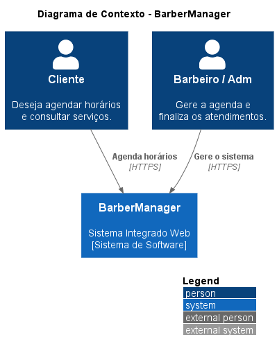
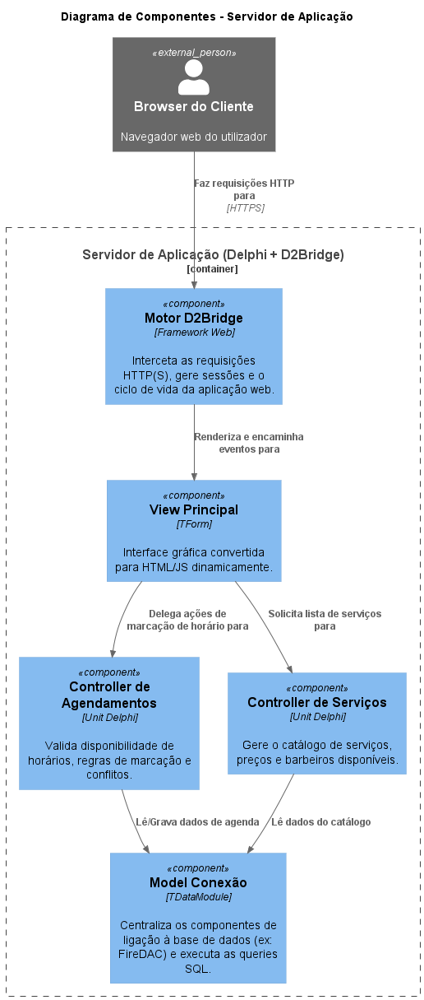
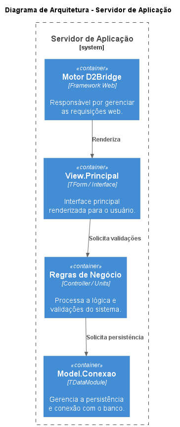
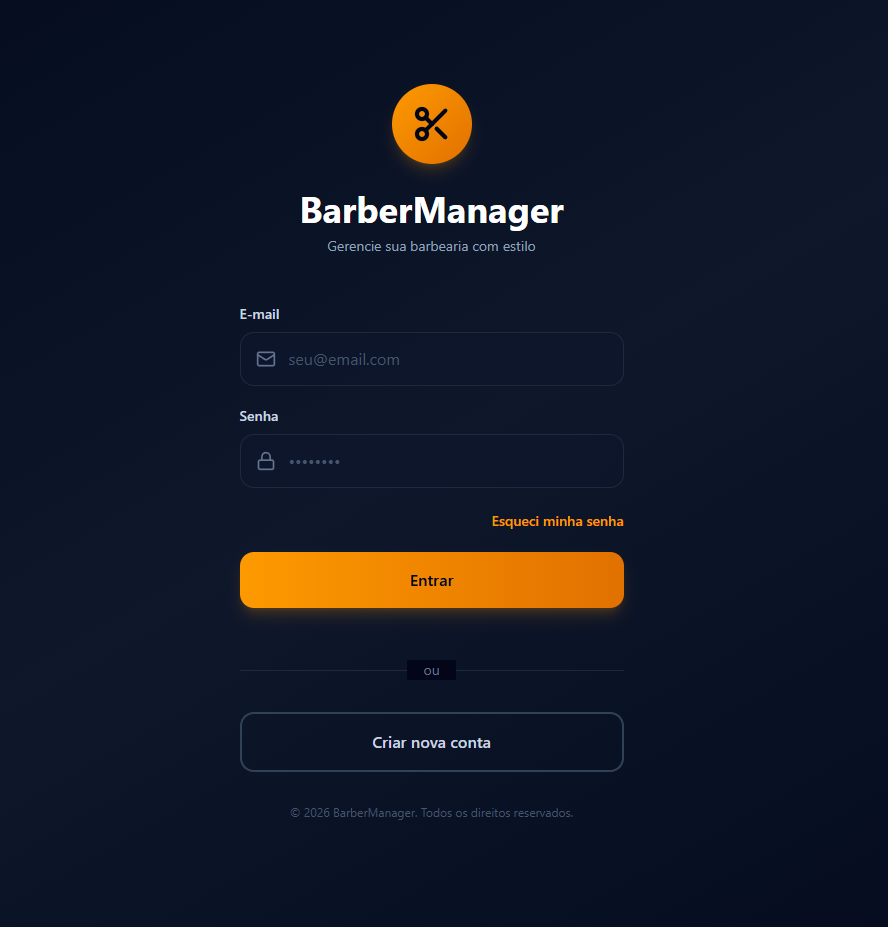
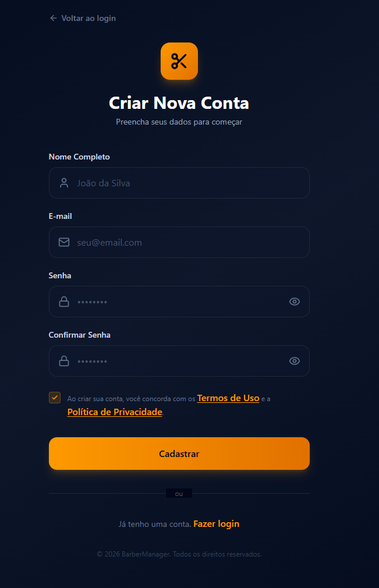
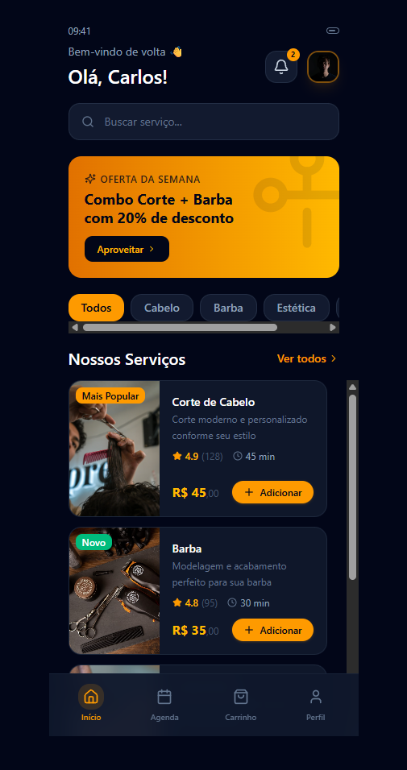
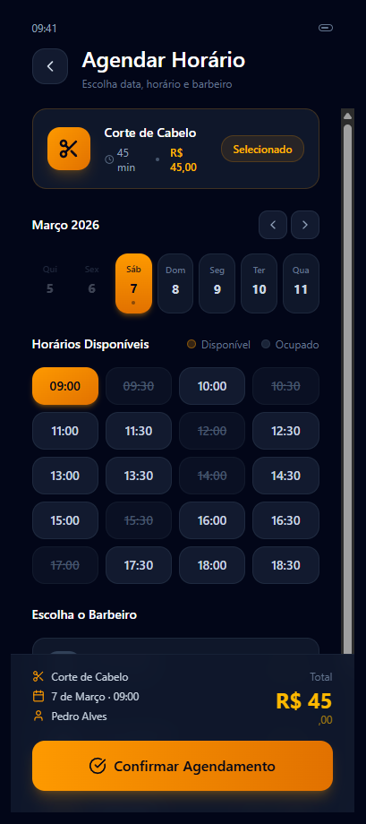
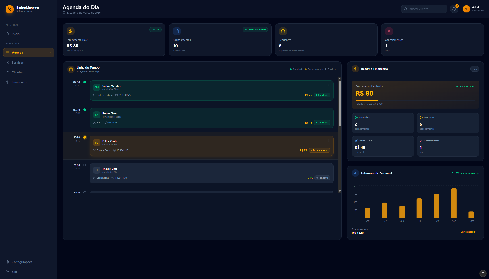
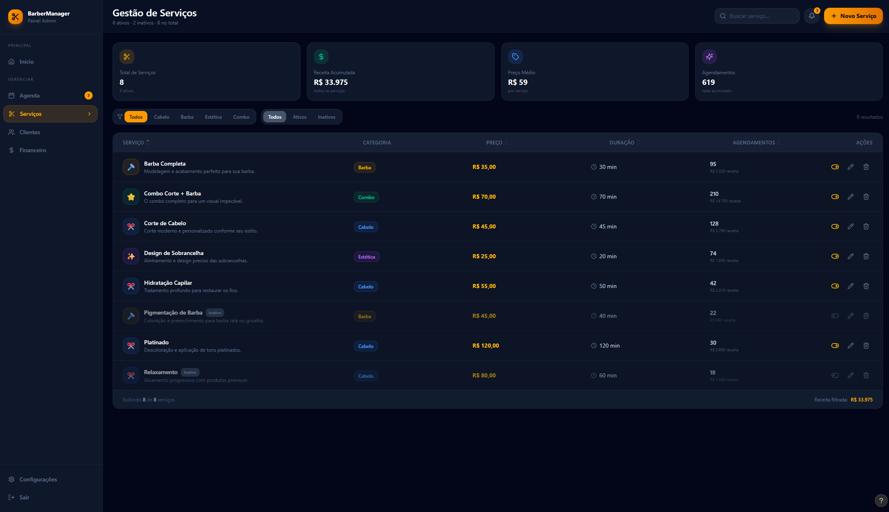

# BarberManager

**BarberManager** é um sistema completo e moderno para a gestão de barbearias, projetado para revolucionar a conexão entre barbeiros e clientes. O projeto visa eliminar o atrito dos agendamentos manuais e oferecer um controle financeiro e administrativo robusto para os proprietários.

> Este projeto é desenvolvido como requisito da disciplina de **Programação Web**, aplicando boas práticas de Engenharia de Software, UI/UX Design moderno e Arquitetura Limpa.

---

## Sumário

- [Visão Geral do Sistema](#visão-geral-do-sistema)
- [Arquitetura e Tecnologias](#arquitetura-e-tecnologias)
- [Diagramas de Arquitetura (C4 Model)](#diagramas-de-arquitetura-c4-model)
- [Telas e Navegação (Protótipo Interativo)](#telas-e-navegação-protótipo-interativo)
- [Módulos e Funcionalidades](#módulos-e-funcionalidades)
- [Funcionalidades Implementadas (Back-End)](#funcionalidades-implementadas-back-end)
- [Estrutura do Repositório](#estrutura-do-repositório)
- [Próximos Passos (Roadmap)](#próximos-passos-roadmap)
- [Como Executar Localmente](#como-executar-localmente)

---

## Visão Geral do Sistema

O sistema é dividido em dois universos distintos, compartilhando a mesma base de código (**Single Codebase**) graças ao poder do Delphi FMX:

- **App Mobile (Para Clientes):** Focado na experiência do usuário (UX), permitindo cadastro ágil, escolha de serviços e agendamento de horários em poucos cliques.
- **Dashboard Web/Desktop (Para Administradores):** Um painel de controle de alta produtividade (resolução 1280x720) para os barbeiros gerenciarem a fila de espera, serviços oferecidos e o faturamento diário.

---

## Arquitetura e Tecnologias

| Item | Detalhe |
|---|---|
| **Linguagem** | Delphi (Object Pascal) |
| **Framework de Interface** | FMX (FireMonkey) — compilação nativa para Windows, Android, iOS e Web |
| **Paradigma UI** | Single Page Application (SPA) com `TTabControl` (Mobile) e injeção de `TFrames` (Desktop) |
| **Modelagem** | C4 Model (Contexto, Componentes e Servidor) |
| **Banco de Dados** | Firebird 3.0 (servidor local via protocolo Local) |
| **Acesso a Dados** | FireDAC — componentes criados inteiramente por código (sem designer) |
| **Segurança** | Hash SHA-256 (via `System.Hash.THashSHA2`) para armazenamento de senhas |

---

## Diagramas de Arquitetura (C4 Model)

A arquitetura do sistema foi modelada seguindo o **C4 Model**, que descreve o software em diferentes níveis de abstração — do contexto geral até os componentes internos e a infraestrutura de servidor.

---

### Diagrama de Contexto

> Visão macro do sistema: mostra o BarberManager e como ele se relaciona com os atores externos (Cliente, Barbeiro/Admin) e sistemas de terceiros.



---

### Diagrama de Componentes

> Detalha os principais componentes internos da aplicação e suas responsabilidades, evidenciando a separação entre o universo Mobile (Cliente) e Desktop (Admin).



---

### Diagrama de Servidor

> Representa a infraestrutura de implantação planejada, incluindo a comunicação entre os clientes, o servidor de aplicação e o banco de dados.



---

## Telas e Navegação (Protótipo Interativo)

Atualmente, o projeto encontra-se na fase de **Integração Front × Back**, onde todas as telas estão conectadas ao banco de dados Firebird e os dados são carregados e persistidos em tempo real.

---

### Universo Cliente — App Mobile

---

#### Tela 01 — Login

> Acesso seguro com design limpo e logo em destaque. Ponto de entrada principal do app mobile.



---

#### Tela 02 — Criar Nova Conta

> Formulário amigável de cadastro com ícones ilustrativos e identificação visual clara para novos usuários.



---

#### Tela 03 — Home do Cliente

> Carrossel de categorias de serviços, banners de ofertas em destaque e listagem de serviços disponíveis.



---

#### Tela 04 — Agendamento

> Motor de agendamento completo: calendário interativo, grade de horários disponíveis via `FlowLayout` e tela de confirmação do pedido.



---

### Universo Administrador — Dashboard Web/Desktop

---

#### Tela 05 — Dashboard Administrativo

> Visão geral financeira com KPIs principais (Faturamento, Ticket Médio, Agendamentos Pendentes) e Linha do Tempo da agenda do dia.



---

#### Tela 06 — Gestão de Serviços

> Catálogo dinâmico de serviços com filtros, contadores, e ações rápidas de edição e exclusão — construído com componentes nativos, sem dependências de terceiros.



---

> **Nota:** Para visualizar as imagens em alta resolução, acesse o diretório [`docs/Telas/`](docs/Telas/) neste repositório.

---

## Módulos e Funcionalidades

### Módulo Cliente *(Front-End + Back-End Concluídos)*

- [x] Autenticação (Login e Cadastro com ícones nos inputs)
- [x] Login real com validação no banco de dados e hash SHA-256
- [x] Navegação por "Bottom Navigation" (Início, Agenda, Carrinho, Perfil)
- [x] Catálogo de Serviços carregado dinamicamente de `TB_SERVICOS`
- [x] Filtros de categoria funcionais (Todos / Cabelo / Barba / Estética)
- [x] Motor de Agendamento completo (Serviço + Barbeiro + Horário)
- [x] Persistência do agendamento em `TB_AGENDAMENTOS` com cálculo automático de `HR_FIM`

### Módulo Barbeiro/Admin *(Front-End + Back-End Concluídos)*

- [x] Sidebar de Navegação responsiva
- [x] Cards de Resumo Financeiro com dados reais do dia (KPIs via query agregada)
- [x] Linha do Tempo com agendamentos reais, coloridos por status
- [x] Tela de Gestão de Serviços (CRUD completo, ativação/desativação por linha)

---

## Funcionalidades Implementadas (Back-End)

> Esta seção detalha o que foi efetivamente desenvolvido e integrado com o banco de dados Firebird nas Fases 5, 6 e 7.

---

### Conexão ao Banco de Dados — `Model.Conexao.pas`

> `TdmConexao` é um DataModule singleton criado inteiramente por código (sem componentes no designer), garantindo portabilidade e controle total da conexão FireDAC.

- Conexão ao Firebird 3.0 via protocolo Local (`fbclient.dll`)
- CharacterSet UTF-8, credenciais configuradas em código
- `FDConnection1` exposto como `public` para acesso por todos os Forms e Frames

---

### Autenticação Real — `View.Principal.pas`

> O login deixou de ser simulado e passou a validar as credenciais diretamente na tabela `TB_USUARIOS`.

- Query à `TB_USUARIOS` com filtro por e-mail e hash SHA-256 da senha
- Redirecionamento automático: perfil `CLIENTE` → Home Mobile; perfil `ADMIN` → Dashboard Desktop
- Senha armazenada como SHA-256 em maiúsculas (`UpperCase(THashSHA2.GetHashString(...))`)

---

### Catálogo de Serviços Dinâmico

> Os cards de serviços na Home do cliente são criados programaticamente a partir dos registros ativos em `TB_SERVICOS`.

- Cards (`TLayout`) criados em runtime com `Align=None` e `Position.Y` explícito
- Filtros de categoria aplicam cláusula `WHERE CATEGORIA = :CAT` dinamicamente
- Cor e estado visual atualizados via `StyledSettings := []` + `TextSettings.FontColor`

---

### Motor de Agendamento

> Fluxo completo: o cliente seleciona serviço → barbeiro → horário → confirma. O registro é inserido no banco de dados.

- Barbeiros carregados de `TB_BARBEIROS` com JOIN a `TB_USUARIOS`
- 20 slots de horário gerados programaticamente no `TFlowLayout`, com estados disponível/ocupado
- `HR_FIM` calculado automaticamente com `IncMinute(HR_INICIO, DURACAO_MIN)`
- INSERT em `TB_AGENDAMENTOS` com todos os campos (cliente, barbeiro, serviço, datas, valor)

---

### Dashboard Administrativo com KPIs Reais

> Os dados exibidos no painel deixaram de ser estáticos — são calculados em tempo real a partir dos agendamentos do dia.

- Query agregada a `TB_AGENDAMENTOS` com filtro `DT_AGENDAMENTO = CURRENT_DATE`
- KPIs atualizados: Faturamento (`SUM`), Total, Pendentes e Cancelados (`SUM CASE WHEN`)
- Linha do Tempo: JOIN entre `TB_AGENDAMENTOS`, `TB_USUARIOS`, `TB_BARBEIROS` e `TB_SERVICOS`
- Cards dinâmicos na linha do tempo com cores por status: Concluído / Em Andamento / Pendente / Cancelado

---

## Estrutura do Repositório

```
BarberManager
 ┣ database
 ┃ ┗ migrations                   # Scripts SQL incrementais (o .FDB não é versionado)
 ┣ docs
 ┃ ┣ Arquitetura                  # Relatório de arquitetura (PDF e fonte LaTeX)
 ┃ ┣ Diagramas_C4                 # Diagramas C4 Model (.puml e imagens)
 ┃ ┣ Qualidade                    # Relatório SonarQube, relatório de testes e BUGS_ENCONTRADOS.md
 ┃ ┣ Requisitos                   # Documento de requisitos
 ┃ ┣ Telas e Telas_Web            # Protótipos de UI/UX
 ┃ ┗ images                       # Ícones e imagens usados na documentação
 ┣ src
 ┃ ┣ API                          # API REST em Delphi (Horse): Auth, Serviços, Agendamentos, Clientes...
 ┃ ┣ Model                        # DataModule de conexão FireDAC/Firebird
 ┃ ┣ View                         # Telas FMX: Principal, Dashboard e Frames (Serviços, Agenda, Clientes, Financeiro, Configurações)
 ┃ ┣ Web                          # Front-end web em HTML/CSS/JS servido pela API
 ┃ ┗ assets                       # Imagens dos serviços
 ┣ tests
 ┃ ┗ postman                      # Coleção e ambiente Postman/Newman
 ┣ BarberManagerAPI.dpr           # Projeto da API REST
 ┣ sonar-project.properties       # Configuração da análise SonarQube
 ┣ start-barbermanager.ps1        # Script de inicialização
 ┣ CLAUDE.md                      # Contexto técnico do projeto para o assistente de IA
 ┗ README.md                      # Esta documentação
```

---

## Próximos Passos (Roadmap)

A metodologia de desenvolvimento adotada separa estritamente o **Front-end** do **Back-end**. Estado atual das fases:

- [x] **Fase 1:** Definição de Escopo e Requisitos
- [x] **Fase 2:** Design System e Protótipos no Figma
- [x] **Fase 3:** Construção do Front-End (UI) no Delphi FMX
- [x] **Fase 4:** Navegação, Transições e UX interativa (Mockups)
- [x] **Fase 5:** Modelagem do Banco de Dados Relacional (DER) e criação do schema Firebird
- [x] **Fase 6:** Criação do Back-End (Regras de Negócio — Conexão, Login, Agendamento, KPIs)
- [x] **Fase 7:** Integração Front × Back (Data Binding e Persistência) — parcial
- [x] **Fase 8:** CRUD completo de Serviços e frames do Admin (Agenda, Clientes, Financeiro, Configurações)
- [ ] **Fase 8b:** Versão web: API REST em Horse (`src/API`) + front-end HTML/CSS/JS (`src/Web`); deploy público pendente
- [ ] **Fase 9:** Testes Automatizados da API (Postman/Newman) — em andamento
  - [x] Módulo Auth (login válido, senha inválida, email não cadastrado)
  - [x] Módulo Servicos (CRUD completo + validação, com 3 bugs encontrados e documentados)
  - [x] Módulo Agendamentos (2 bugs críticos encontrados e confirmados em 2 bancos diferentes: sem validação de conflito de horário, valor não calculado)
  - [ ] Módulo Dashboard
  - [ ] Módulo Clientes
  - [ ] Módulo Barbeiros
  - [ ] Módulo Avaliacoes
  - [ ] Módulo Usuarios
  - Ver [`docs/Qualidade/BUGS_ENCONTRADOS.md`](docs/Qualidade/BUGS_ENCONTRADOS.md) para o relatório detalhado de bugs

---

## Como Executar Localmente

### Pré-requisitos

| Requisito | Versão / Detalhe |
|---|---|
| **Delphi** | 12 Athens (Community Edition ou superior) |
| **Firebird** | 3.0 — [download](https://firebirdsql.org/en/firebird-3-0/) |
| **fbclient.dll** | Incluída na instalação do Firebird (`Firebird_3_0\fbclient.dll`) |

---

### 1. Clone o repositório

```bash
git clone https://github.com/miguettohuertas/BarberManager.git
```

---

### 2. Configure o banco de dados

**a)** Certifique-se de que o servidor Firebird 3.0 está instalado em:
```
C:\Program Files (x86)\Firebird\Firebird_3_0\
```

**b)** O arquivo do banco (`BARBERMANAGER.FDB`) **não é versionado** (está no `.gitignore`). Crie um banco Firebird 3.0 com o mesmo nome em `database\` e aplique, em ordem, os scripts de `database\migrations\`.

**c)** Verifique que o caminho em `src\Model\Model.Conexao.pas` aponta para a localização correta:
```pascal
FDConnection1.Params.Database :=
  'C:\ProjetosDelphi\BarberManager\database\barbermanager.fdb';
```
> Ajuste o caminho se tiver clonado o repositório para outra pasta. O mesmo caminho existe em `src\API\API.Conexao.pas`.

---

### 3. Compile e execute

**a)** Abra o arquivo `.dproj` no **Embarcadero Delphi 12**.

**b)** Defina a plataforma alvo como **Windows 32-bit**.

**c)** Pressione `F9` para compilar e executar.

---

### Credenciais de Teste

| Perfil | E-mail | Senha | Acesso |
|---|---|---|---|
| **Administrador** | `admin@barber.com` | `123456` | Dashboard Admin (Desktop) |
| **Cliente** | `carlos@email.com` | `123456` | App Mobile (Home + Agendamento) |

---

### Navegação de Teste

| Ação | Resultado |
|---|---|
| Login com credenciais de **Cliente** | Acesso à Home do Cliente com serviços reais |
| Filtros **Todos / Cabelo / Barba / Estética** | Lista de serviços filtrada dinamicamente do banco |
| Clicar num serviço → **Agendar** | Seleção de barbeiro, horário e confirmação persistida no banco |
| Login com credenciais de **Administrador** | Dashboard com KPIs e linha do tempo do dia atual |
| Menu lateral → **Serviços** | Frame de gestão de serviços (CRUD completo) |
| Menu lateral → **Sair** | Retorno à tela de Login |

---

<p align="center">Desenvolvido como projeto acadêmico — Disciplina de Programação Web</p>
